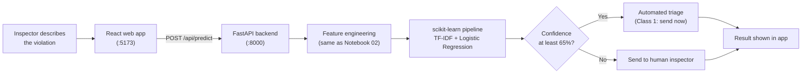

# BuildSafe AI

### Knowing which building violations can't wait

**NYC building violation severity triage: from raw data to a working decision-support web app**

IT3051 Fundamentals of Data Mining · Mini Project 2026 · SLIIT · Group **Mine Minds**

[](https://www.python.org/)
[](https://fastapi.tiangolo.com/)
[](https://react.dev/)
[](https://scikit-learn.org/)
[-success.svg)](#6-model-results)

> **The goal:** turn raw construction violation data into meaningful insights that support faster, more informed safety decisions.

---

## Table of contents

1. [Overview](#1-overview)
2. [Key results](#2-key-results)
3. [How it works](#3-how-it-works)
4. [The data science pipeline](#4-the-data-science-pipeline)
5. [Honest testing: the "answer key" lesson](#5-honest-testing-the-answer-key-lesson)
6. [Model results](#6-model-results)
7. [The web application](#7-the-web-application)
8. [Getting started](#8-getting-started)
9. [API reference](#9-api-reference)
10. [Project structure](#10-project-structure)
11. [Testing](#11-testing)
12. [Limitations and next steps](#12-limitations-and-next-steps)
13. [Team and acknowledgements](#13-team-and-acknowledgements)

---

## 1. Overview

New York City issues more than 50,000 building violations every year. Each one is placed in one of three official classes, and the class decides how fast the city must respond:

| Class | Meaning | Example |
|---|---|---|
| **Class 1** | Immediately hazardous | Cracked bearing wall during demolition |
| **Class 2** | Major | Illegal conversion of an apartment |
| **Class 3** | Lesser | Fence taller than allowed |

Today the class depends on someone choosing the right code from a long legal list. That is slow and can be inconsistent, and a dangerous case can wait in the queue.

**BuildSafe AI** reads a violation, written in the inspector's own words, and predicts which class it belongs to, **with a confidence score**. When the system is not sure, it does not guess: it sends the case to a human inspector.

> BuildSafe is a **decision-support tool**. It supports inspectors and does not replace them.

## 2. Key results

Measured once on a locked, time-ordered test set of **20,554** violations the model never saw.

| Measure | Result |
|---|---|
| Hazardous (Class 1) cases caught | **86.11%** (target was at least 80%) |
| Overall accuracy | **82.23%** |
| Macro-F1 (all three classes equally) | **0.7711** (95% bootstrap CI 0.7609 to 0.7807) |
| Macro AUC (one-vs-rest) | **0.9423** |
| Hazardous cases wrongly called lesser | **0.25%** (21 of 8,455) |
| Weakest area: lesser (Class 3) cases caught | 71.85% |

**Human-review rule:** below **65% confidence**, a human inspector decides. On the test set, about 79% of cases are decided automatically, and hazardous-case coverage rises from about 86% to about 94% once people check the unsure ones.

## 3. How it works



**Describe → Predict → Act.** The inspector describes the case, BuildSafe predicts the class and its confidence, and the case is routed: confident hazardous cases go to the front, unsure cases go to a person.

## 4. The data science pipeline

| Stage | What was done | Where |
|---|---|---|
| **EDA** | Data audit of the NYC DOB ECB Violations dataset (156,749 records, 46 columns, Jan 2024 to Sep 2026): missing values, duplicates, class balance, leakage checks | `notebooks/01_BuildSafe_EDA.ipynb` |
| **Preprocessing and features** | Leakage removal, text cleaning, date features, respondent type, building-history features (strictly backward-looking), TF-IDF text vectors, encoding | `notebooks/02_BuildSafe_Preprocessing.ipynb` |
| **Text experiments** | Word2Vec text representation experiment | `notebooks/03_BuildSafe_Word2Vec.ipynb` |
| **Model development (Stage 6)** | Baseline comparison of candidate models with time-ordered cross-validation | `notebooks/Models/06_Model_Development.ipynb` |
| **Optimisation and selection (Stage 7)** | Hyper-parameter tuning, feature-count and class-weight studies, pre-declared selection rule, final locked test | `notebooks/Models/07_Model_Optimization_and_Final_Selection.ipynb` |
| **Backend (Stage 9)** | FastAPI service that loads the saved pipeline and serves predictions | `backend/` |
| **Frontend (Stage 10)** | React web app for single, batch and model-insight views | `frontend/` |

**Main design decisions**

- **Time-ordered split:** train on the past, test on the future, as the system would be used in real life.
- **Imbalanced classes:** lesser violations are only about 4% of the data, so class weights are used and the model is judged on Macro-F1 and Class 1 recall, not on accuracy alone.
- **Text is the main signal:** the inspector's description carries most of the predictive information, so TF-IDF word and phrase features are used (up to 40,000).
- **Final model:** tuned Logistic Regression inside one scikit-learn pipeline, trained on 81,780 violations (1 Jan 2025 to 12 May 2026) and tested on later ones (13 May to 10 Sep 2026).

## 5. Honest testing: the "answer key" lesson

Our first experiment scored about **98%**. It was cheating: one column, the legal infraction code, already contains the class, so the model simply looked up the answer. That code does not exist yet when a new violation arrives in real life.

We removed everything that would not be known at the moment a violation is issued:

- infraction codes and the law-section text that mirrors them,
- fines, payments and balances (they come after the case),
- hearing, certification and ECB status fields,
- class words typed into the notes (masked in the text).

The honest score on unseen cases is **about 82%**. We would rather report an honest 82% than a fake 98%.

## 6. Model results

### Candidates compared (Stage 7, time-ordered cross-validation)

Five tuned methods landed within a few points of each other. Selection followed a rule written **before** scoring: eligibility guard-rails first (Class 1 recall at least 0.80, Class 3 recall at least 0.55, calibrated probabilities), then Macro-F1, with ties broken by Class 1 recall and speed.

| Model | CV Macro-F1 | Class 1 recall | Class 3 recall | Calibrated probabilities | Outcome |
|---|---|---|---|---|---|
| **Logistic Regression (tuned)** | 0.7719 | 0.8408 | 0.7300 | Yes | **Selected** |
| LightGBM (tuned) | 0.7748 | 0.8422 | 0.6498 | Yes | Tied within 0.005, lower Class 3 recall |
| Random Forest (tuned) | 0.7727 | 0.8231 | 0.6024 | Yes | Tied within 0.005, lower Class 3 recall |
| Linear SVM (tuned) | 0.7768 | 0.8316 | 0.6719 | No | Disqualified (no probabilities) |
| XGBoost (tuned) | 0.7654 | 0.8495 | 0.7060 | Yes | Lower Macro-F1 |

Logistic Regression was chosen because it is close to the top on score, gives an honest confidence percentage (which the 65% human-review rule needs), and is fast and small (about 2 MB).

Full tables and figures are in `results/` (for example `stage7_candidates.csv`, `final_model_decision.json`, and `results/figures/`).


## 7. The web application

| Page | What it does |
|---|---|
| **Predict Severity** | Enter one violation (description, borough, violation type, respondent, issue date, aggravation level, building ID). Shows the class in plain English, the confidence, all three probabilities, and a **"Send to human inspector"** warning when confidence is below 65%. Includes quick demo presets, live respondent-type detection, building history lookup, and a view of the exact features sent to the model. |
| **Batch Prediction** | Upload a CSV of violations, get a prediction for every row, see how many are flagged for review, and download the triage report. |
| **Dashboard** | System overview with class distribution and model comparison charts. |
| **Model Intelligence** | Model card, candidate comparison, top features, and error analysis. |

Batch CSV files need these columns: `description`, `borough`, `violation_type`, `respondent`, `issue_date`, `bin`.

## 8. Getting started

### Prerequisites

- **Python 3.13+**
- **Node.js** (current LTS) and npm

### Install

```bash
git clone https://github.com/gima2003/BuildSafe-AI.git
cd BuildSafe-AI

# Python environment
python -m venv .venv
# Windows:  .venv\Scripts\activate
# macOS/Linux:  source .venv/bin/activate
pip install -r requirements.txt

# Frontend dependencies
cd frontend
npm install
cd ..
```

### Run the app

**Option A: one command**

```bash
python start_app.py
```

On Windows you can also double-click `start_all.bat`.

**Option B: two terminals**

```bash
# Terminal 1: backend
python backend/run.py

# Terminal 2: frontend
cd frontend
npm run dev
```

Then open:

- Web app: <http://localhost:5173>
- API docs (Swagger): <http://127.0.0.1:8000/docs>

> The app runs locally as a working prototype. It is not deployed to a public server.

### About the data

The raw dataset is **not included** in this repository. The app does not need it: it runs from the saved files in `models/` and `artifacts/`. To re-run the notebooks, download **DOB ECB Violations** from [NYC Open Data](https://opendata.cityofnewyork.us/) and place the files in `data/`.

## 9. API reference

Base URL: `http://127.0.0.1:8000`

| Method | Endpoint | Description |
|---|---|---|
| `GET` | `/api/health` | Service health and loaded package versions |
| `POST` | `/api/predict` | Predict one violation |
| `POST` | `/api/predict/batch` | Predict a list of violations (JSON) |
| `POST` | `/api/predict/csv` | Predict from an uploaded CSV file |
| `GET` | `/api/lookup/bin/{bin_id}` | Building history for a 7-digit building ID |
| `GET` | `/api/lookup/metadata` | Dropdown options and demo presets |
| `GET` | `/api/model/info` | Model card information |
| `GET` | `/api/model/metrics` | Test metrics and top features |
| `GET` | `/api/model/candidates` | Candidate model comparison table |

**Example request**

```bash
curl -X POST http://127.0.0.1:8000/api/predict \
  -H "Content-Type: application/json" \
  -d '{
    "description": "FAILURE TO MAINTAIN BUILDING WALL CRACKING OBSERVED ON BEARING WALL. CEASE USE.",
    "borough": "1",
    "violation_type": "Construction",
    "respondent": "ABC CORP LLC",
    "issue_date": "2026-06-12",
    "bin": "1000007",
    "aggravation_level": "NO"
  }'
```

`borough` is `"1"` Manhattan, `"2"` Bronx, `"3"` Brooklyn, `"4"` Queens, `"5"` Staten Island. `aggravation_level` is `"NO"`, `"AGGRAVATED OFFENSE LEVEL 1"` or `"AGGRAVATED OFFENSE LEVEL 2"`.

**Example response (shortened)**

```json
{
  "predicted_class": "CLASS - 1",
  "meaning": "Immediately hazardous",
  "confidence": 0.9947,
  "probabilities": { "CLASS - 1": 0.9947, "CLASS - 2": 0.0041, "CLASS - 3": 0.0011 },
  "needs_human_review": false,
  "review_reason": "Confident automated triage (99.5% certainty). ...",
  "engineered_features": { "...": "..." }
}
```

## 10. Project structure

```
BuildSafe-AI/
├── backend/                        # FastAPI service
│   ├── app/
│   │   ├── main.py                 # App and CORS setup
│   │   ├── config.py               # Paths, thresholds, schema definitions
│   │   ├── schemas.py              # Request and response models
│   │   ├── preprocessor.py         # Feature engineering (mirrors Notebook 02)
│   │   ├── predictor.py            # Loads the pipeline, runs predictions
│   │   └── routes/                 # health, predict, model, lookup
│   └── run.py                      # Starts the server on port 8000
├── frontend/                       # React 19 + Vite + Tailwind CSS
│   └── src/
│       ├── pages/                  # Dashboard, PredictSeverity, BatchPrediction, ModelIntelligence
│       ├── components/dashboard/   # Sidebar, ErrorIntelligence
│       └── services/api.js         # REST client
├── notebooks/                      # EDA, preprocessing, text experiments
│   └── Models/                     # Stage 6 and Stage 7 notebooks
├── models/                         # Trained pipeline (.joblib) and model card (.json)
├── artifacts/                      # Building history lookup, preprocessing config, class weights
├── results/                        # Experiment tables, final decision record, figures/
├── data/                           # Raw data goes here (not committed)
├── start_app.py                    # Cross-platform launcher
├── start_all.bat                   # Windows launcher
├── test_system.py                  # End-to-end smoke test
└── requirements.txt                # Python dependencies
```

**Tech stack:** Python, FastAPI, Uvicorn, Pydantic, scikit-learn, pandas, NumPy, SciPy, joblib · React 19, Vite, Tailwind CSS 4, Recharts, Lucide icons.

## 11. Testing

Run the end-to-end smoke test (checks every API endpoint and the prediction pipeline):

```bash
python test_system.py
```

Known gaps found during testing, planned for a future version:

- Invalid inputs (a wrong building ID, date or borough) are currently accepted instead of rejected. Input checks should be added.
- The built-in "minor violation" demo preset can be predicted as Class 2, so Class 3 coverage needs more training examples.

## 12. Limitations and next steps

**Limitations**

- **New York data only.** Other cities have different rules and wording, so results cannot be assumed to transfer.
- **Not yet tested in a real workflow.** Results come from past records, not from live inspector use.
- **Weaker on lesser (Class 3) violations**, which are rare in the data (about 4%).
- It is a **decision-support tool**, not a replacement for inspectors.

**Next steps**

- Run a small pilot alongside today's process and measure two things: are dangerous cases seen sooner, and do inspectors agree with the system?
- Keep the 65% human-review rule.
- Add input validation, collect more lesser-violation examples, and retrain regularly with inspector feedback.
- Extend beyond New York only after testing.

## 13. Team and acknowledgements

**Group Mine Minds**, IT3051 Fundamentals of Data Mining, Sri Lanka Institute of Information Technology (SLIIT)

- Pabodha P G
- Fernando A S S
- Wickramarathna G W W N
- Kularatne P S C

Thank you to our lecturer **[Lecturer name]** for the guidance throughout this module, and to our viva instructor **[Viva instructor name]** for the thoughtful questions and feedback.

**Data source:** NYC Open Data, DOB ECB Violations (NYC Department of Buildings).

*This is an academic project. It is a prototype and should not be used as the only basis for real safety decisions.*
